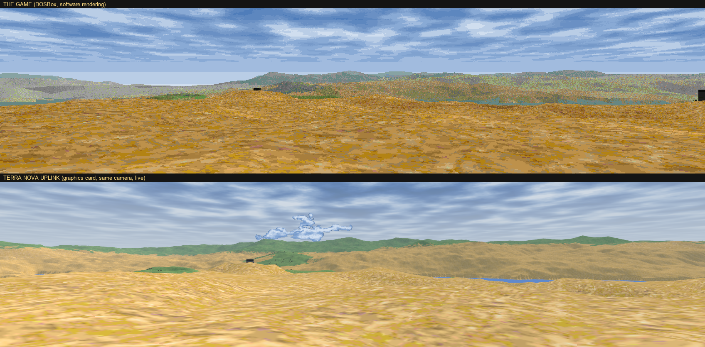
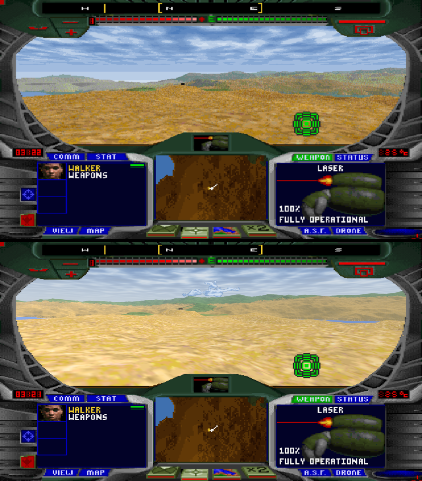

# Terra Nova Uplink

*Terra Nova: Strike Force Centauri* (1996) redessiné en 3D moderne. Deux façons de s'en servir :

- **Visualiseur de cartes** : survoler toutes les cartes du jeu.
- **Mode Live** (prototype) : jouer au vrai jeu dans DOSBox pendant qu'Uplink le redessine en direct sur la carte graphique, cockpit compris.

Tout est lu depuis ta propre copie du jeu (GOG ou Steam). Aucun fichier du jeu n'est fourni.

*English version: [README.md](README.md)*

## Visualiseur de cartes

1. Avoir le jeu installé (GOG ou Steam).
2. Télécharger [Godot 4.7](https://godotengine.org/download/windows/) (version standard) et le dézipper.
3. Télécharger ce dépôt (**Code** → **Download ZIP**), le dézipper et double-cliquer sur **`Map viewer.bat`**.

Si le jeu n'est pas trouvé, Uplink demande son dossier. La première ouverture d'une carte prend quelques secondes.

| Touche | Action |
|---|---|
| Clic droit + souris | regarder |
| ZQSD / WASD | se déplacer |
| Espace / Ctrl | monter / descendre |
| Maj | plus vite |
| Molette | vitesse |
| Tab | liste des missions |
| F2 / F3 / F4 | étiquettes / repères de mission / arbres |

Contenu :

- Les 37 missions de la campagne, l'entraînement, les deux missions coupées, les cartes du générateur de missions et les démos
- Les vraies textures du sol, modèles 3D, soldats, forêts et ciels du jeu
- Une galerie des 119 modèles 3D (dernière entrée de la liste)

Petite trouvaille : des têtes de l'île de Pâques sont cachées sur la planète rouge dans *Opération Taudis*.

## Mode Live (prototype)

Le jeu tourne toujours dans DOSBox : c'est bien le vrai jeu qui joue. Un petit pont en Python lit son état dans la mémoire de DOSBox environ 120 fois par seconde (caméra, unités, articulations des soldats, tirs, explosions, ciel, écran du cockpit), et Uplink dessine la même scène sur la carte graphique, avec le vrai cockpit du jeu par-dessus. On joue depuis la fenêtre d'Uplink : clavier et souris sont renvoyés au jeu.

Le cockpit, dans le jeu (en haut) et sur la 3D d'Uplink (en bas) :

1. Installer [Python 3](https://www.python.org/downloads/) 64 bits, puis lancer `pip install numpy psutil`.
2. Lancer le jeu avec [Terra Nova Plus](https://github.com/skw-1337/terra-nova-plus), Display **HD 848x480** (le mode Live ne gère pas encore le 1280x720).
3. Double-cliquer sur **`Live (prototype).bat`**. Il trouve la mission en cours et ouvre Uplink dessus. Ça marche aussi depuis les menus.
4. Cliquer dans la fenêtre pour prendre la souris : la souris regarde, les boutons tirent et verrouillent. `Y` ou `Pause` donne le curseur du jeu (boutons du cockpit, carte) et revient. `F12` active ou coupe le look « old school » (les pixels et la palette du jeu). Toutes les autres touches vont au jeu.

Fermer Uplink pour arrêter. Les menus, briefings et vidéos s'affichent tels que le jeu les dessine. Pour des cinématiques HD, `tools/upscale_movies.py` agrandit une fois les vidéos du jeu sur ton PC (il faut ffmpeg, Real-ESRGAN et RIFE).

C'est un prototype : Windows seulement, quelques effets d'armes ne sont pas encore dessinés, et le pont écrit dans la mémoire du jeu pour tes commandes, comme Terra Nova Plus.

Pour les moddeurs : [notes techniques](docs/formats.md) (en anglais).

## Mentions

Projet de fan, sans lien avec les ayants droit du jeu ni avec la Godot Foundation. Fait avec [Godot](https://godotengine.org). Il faut sa propre copie du jeu. Code sous [licence MIT](LICENSE).
