# Terra Nova Uplink

*Terra Nova: Strike Force Centauri* (Looking Glass, 1996) redessiné en 3D moderne pendant que le vrai jeu continue de tourner dessous. Il utilise ta propre copie du jeu (GOG ou Steam). Aucun fichier du jeu n'est fourni.

*Réalisé avec l'aide de Claude Code (un outil de programmation par IA), surtout pour la rétro-ingénierie du jeu et l'écriture du code. Chaque changement est testé dans le vrai jeu avant d'être publié.*

*English version: [README.md](README.md)*

> **La 2.8 est en bêta.** Préréglages graphiques, roue d'ordres pour l'escouade, menu en jeu, options d'accessibilité et beaucoup de travail sur la coop. Le lanceur la propose (« Try the beta ») et on peut revenir en arrière à tout moment.
> [Liste complète des changements](https://github.com/skw-1337/terra-nova-uplink/releases/tag/v2.8.0-beta.1) · [Images et feuille de route](https://www.ttlg.com/forums/showthread.php?t=153557&p=2545417#post2545417) (en anglais)

## Ce que ça fait

Trois choses, depuis un seul lanceur :

- **Jouer** la campagne : le jeu tourne dans DOSBox et Uplink le redessine en direct, cockpit compris.
- **Coop** (expérimentale) : un ami prend une place dans ton escouade, par Steam.
- **Visualiseur de cartes** : survoler toutes les cartes du jeu sans le lancer.

## Fonctionnalités

Ce qui est nouveau dans la bêta 2.8 est marqué `2.8`.

**En jeu**

- Le vrai cockpit, le HUD et la carte du jeu sur une vue 3D moderne, à la résolution de ton écran
- Visée à la souris, touches modifiables, seconds raccourcis sur la molette et les boutons de souris
- Roue d'ordres pour l'escouade : maintenir un bouton, choisir un ordre, choisir qui le reçoit `2.8`
- Menu en jeu sur Échap : commandes, graphismes, options, accessibilité `2.8`
- Manette, avec touches modifiables `2.8`
- Mode photo `2.8`, captures d'écran, limite d'images par seconde
- Démarrer à n'importe quelle mission de la campagne

**Rendu**

- Préréglages graphiques : Original, Classic+, Modern, Light, avec un aperçu de chaque option `2.8`
- Look old school : les pixels et la palette du jeu, sur une touche
- Armes redessinées d'après les vrais effets du jeu : rayons, traînées, impacts, explosions
- Lumière des tirs, et marques de brûlure là où ils touchent `2.8`
- Traces de pas, traces de véhicules, ombres des nuages `2.8`
- Regarder vers le bas et voir ses propres jambes `2.8`
- Neige, pluie, missions de nuit, et une lumière propre à chaque planète

**Accessibilité** `2.8`

- Modes daltoniens : protanopie, deutéranopie, tritanopie
- Sous-titres des échanges radio de l'escouade, en trois tailles

**Coop** (expérimentale)

- Deux joueurs dans la même mission par Steam : l'un héberge sa campagne, l'autre le rejoint
- Vidéos de briefing et cinématiques de départ sur les deux écrans
- L'invité a le vrai cockpit du jeu, avec son propre son, ses réglages et sa visée `2.8`
- Pas encore là pour l'invité : drone, A.S.F., missiles guidés
- Fonctionnement et dépannage : [COOP.md](COOP.md) (en anglais)

**Lanceur**

- Un seul exe : il trouve ton jeu, installe tout le reste et le garde à jour
- Téléchargements vérifiés, retour à la version précédente, canal bêta
- Musique au choix : Roland / GS, FM, celle du jeu, ou AWE32 avec ta propre image de ROM `2.8`

| | |
|---|---|
| 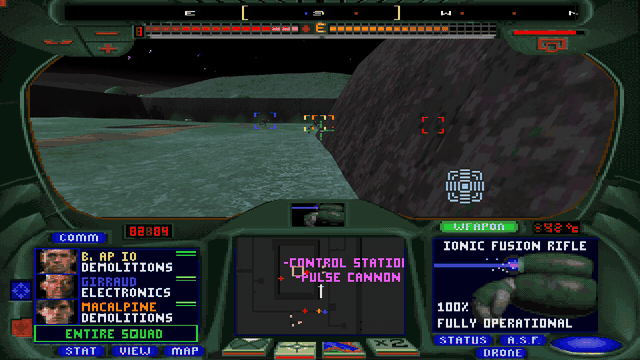 | 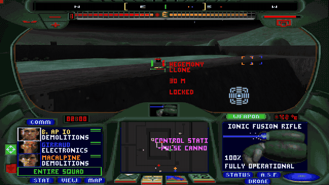 |
| 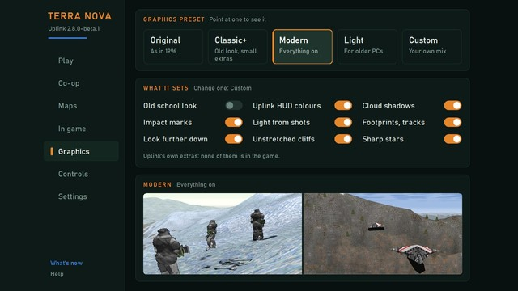 | 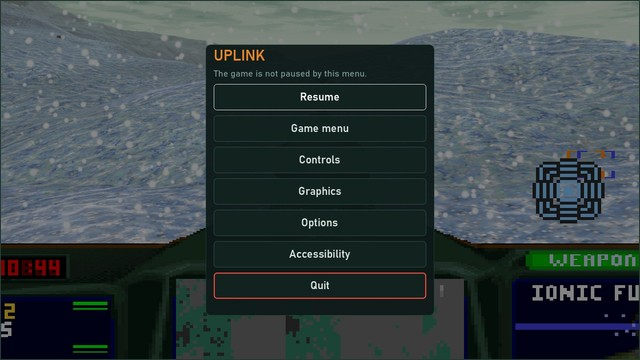 |
| 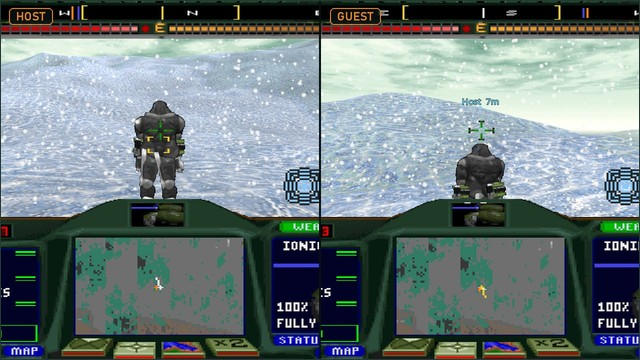 | 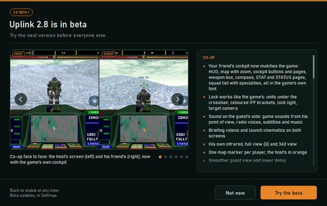 |

## Démarrage rapide

1. Télécharger **Terra Nova Uplink.exe** depuis la [dernière release](https://github.com/skw-1337/terra-nova-uplink/releases/latest).
2. Le mettre dans un dossier vide et le lancer. Il trouve le jeu, télécharge le reste et le garde à jour.
3. Cliquer sur **PLAY** (mode Live), **MAP VIEWER**, ou **HOST A GAME** / **JOIN A FRIEND**.

Windows peut prévenir d'une application inconnue (non signée) : Informations complémentaires, puis Exécuter quand même.

## Mode Live

Même instant : le jeu d'origine, Uplink, et Uplink avec son filtre old school (`F12`).

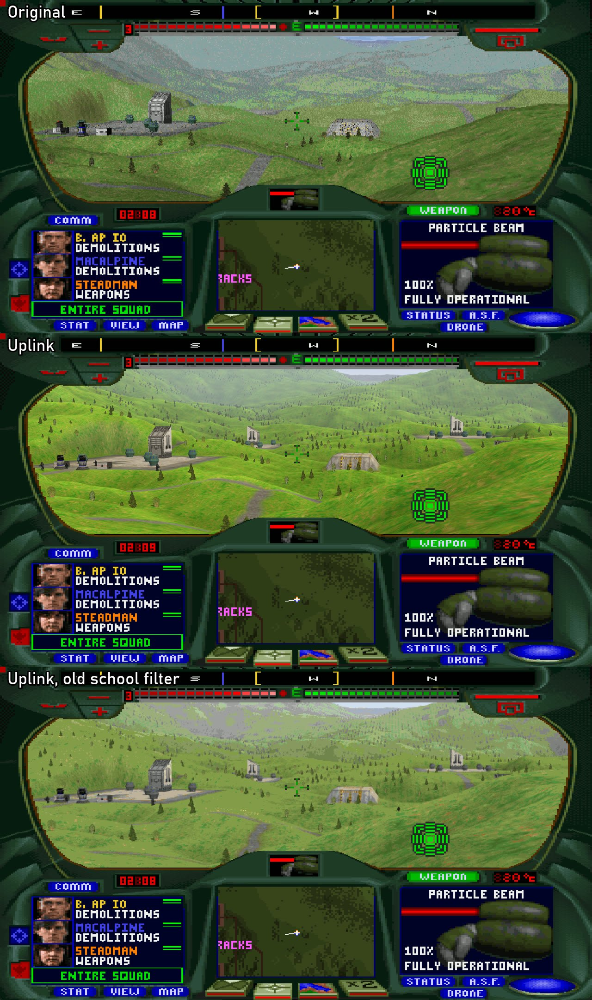

Le jeu tourne toujours dans DOSBox : c'est bien le vrai jeu qui joue. Un petit pont lit son état environ 120 fois par seconde et Uplink dessine la même scène, avec le vrai cockpit du jeu par-dessus.

Cliquer dans la fenêtre pour prendre la souris : elle regarde, les boutons tirent et verrouillent. `Y` ou `Pause` donne le curseur du jeu (boutons du cockpit, carte) ; la touche freelook choisie dans **Game keys** remplace `Y`. `F12` passe au look old school, `Maj+F12` affine ses pixels ; ces deux touches se changent dans le lanceur (**Keys**), qui peut aussi remplacer le réticule par un point ou le cacher. Toutes les autres touches vont au jeu, comme la molette et les boutons de souris réglés dans **Game keys**. Fermer Uplink pour arrêter.

## Galerie

| | |
|---|---|
| 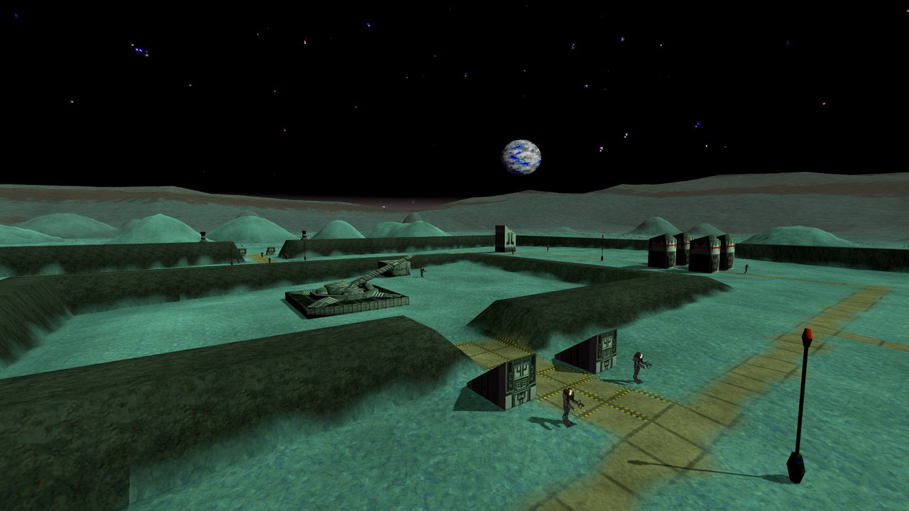 | 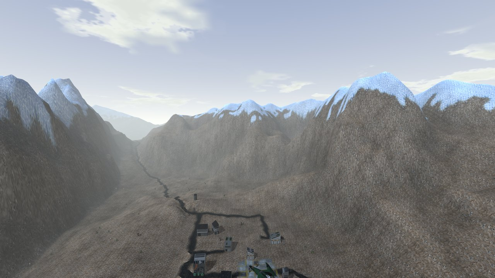 |
| 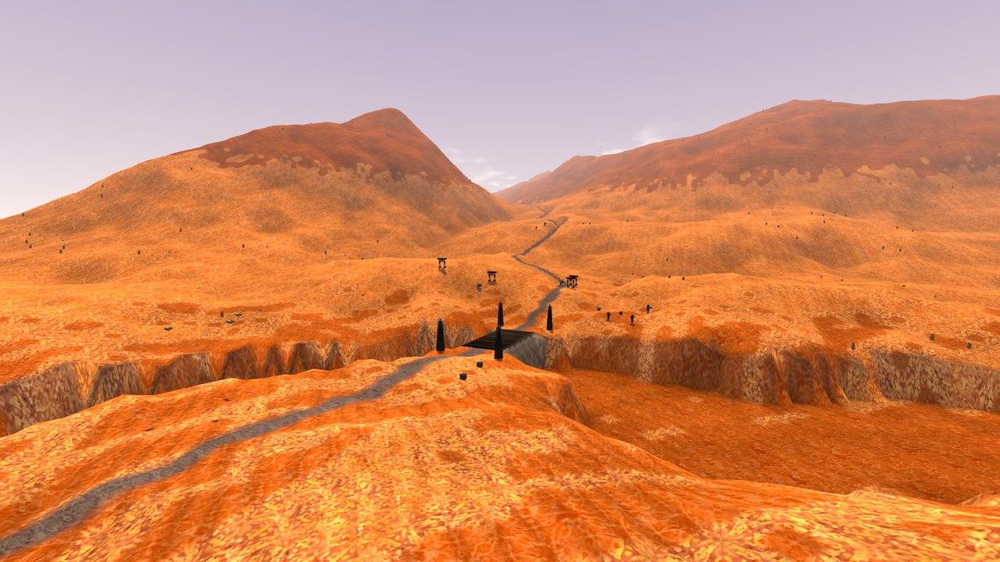 | 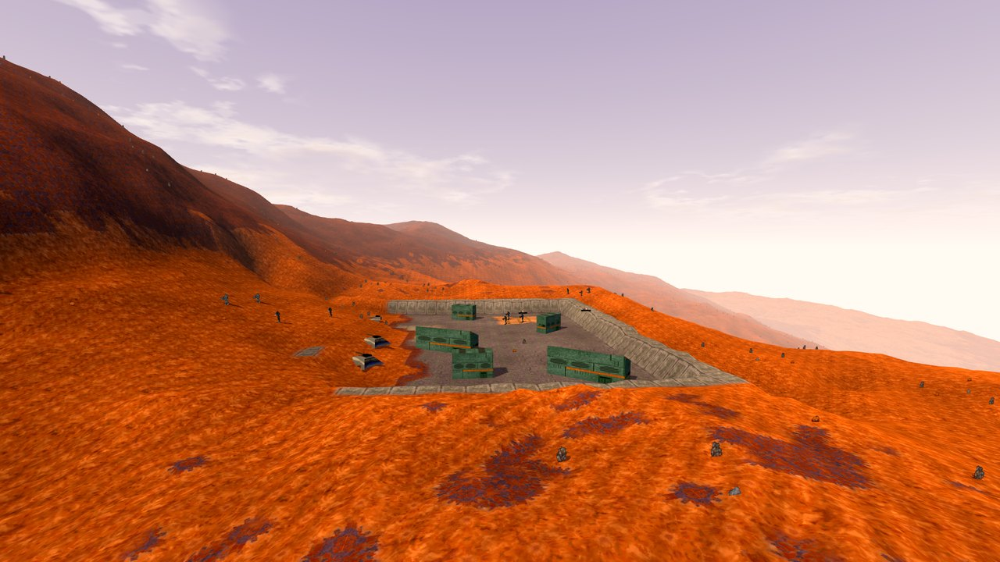 |
| 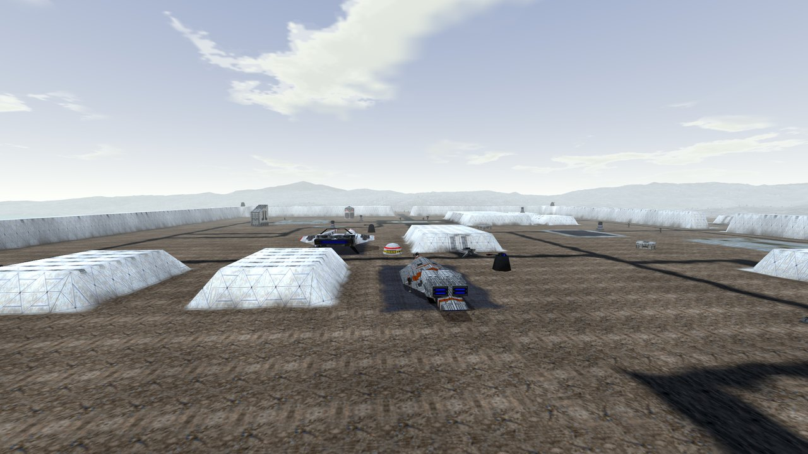 | 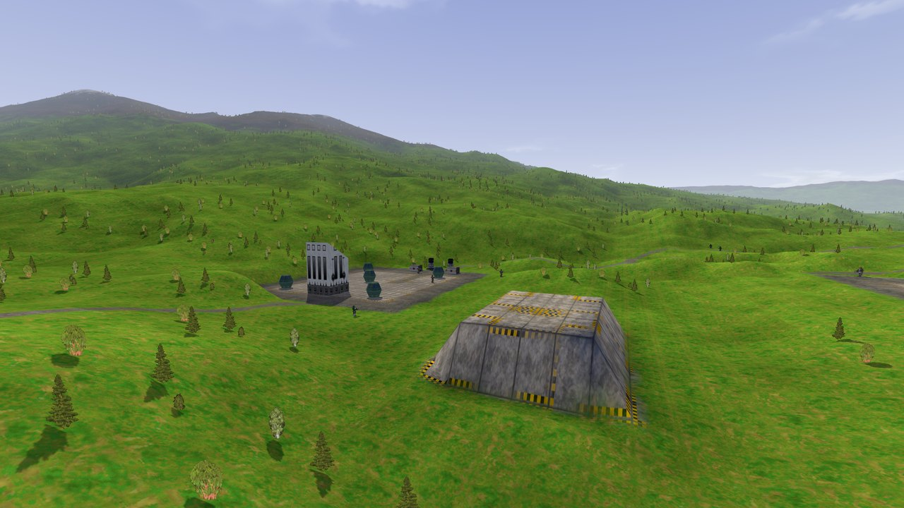 |
| 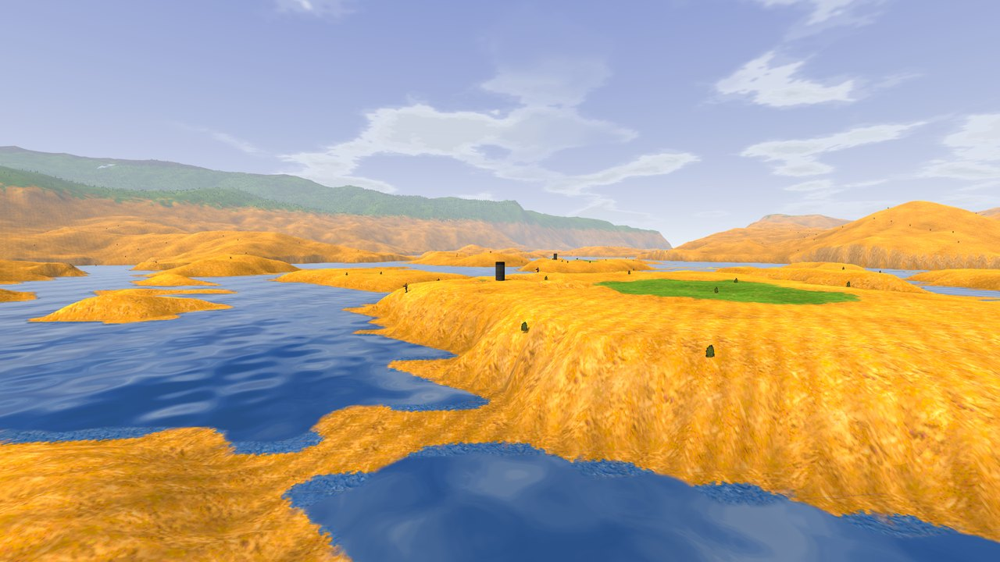 | 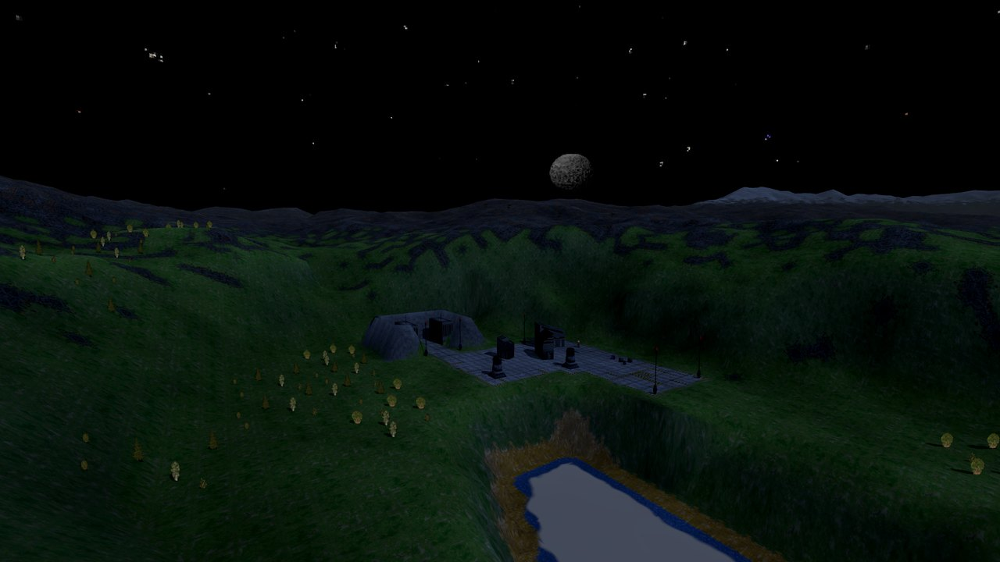 |
| 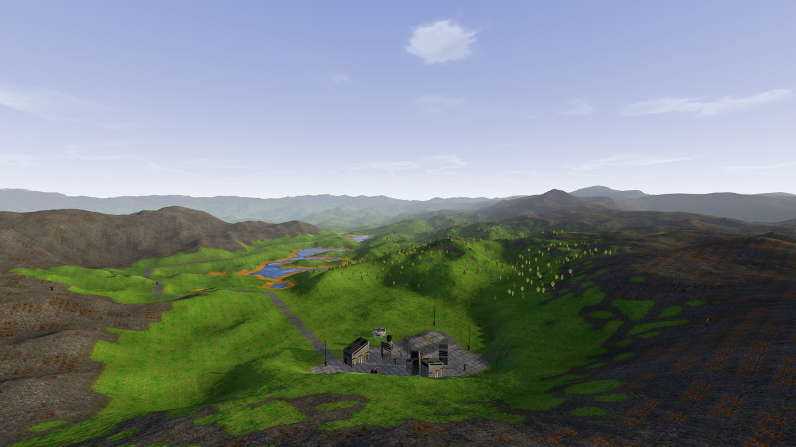 | 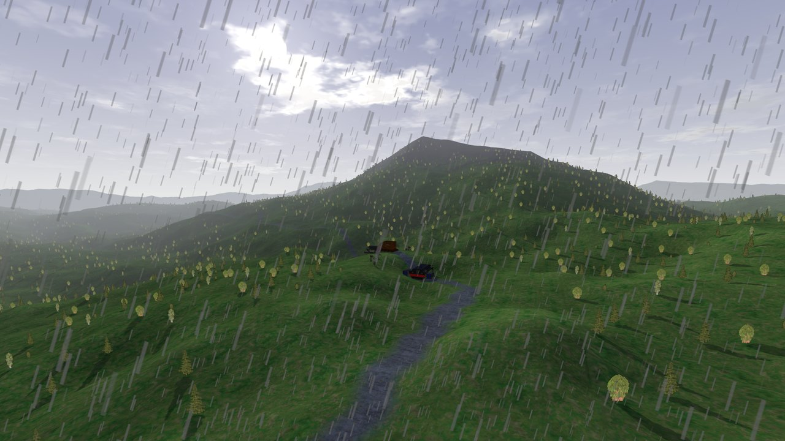 |
|  |  |

## Visualiseur de cartes

Les 37 missions de la campagne, l'entraînement, les deux missions coupées, les cartes du générateur de missions et les démos, avec les vrais sols, modèles 3D, soldats, forêts et ciels du jeu. La dernière entrée de la liste est une galerie des 119 modèles 3D.

| Touche | Action |
|---|---|
| Clic droit + souris | regarder |
| ZQSD / WASD | se déplacer |
| Espace / Ctrl | monter / descendre |
| Maj / molette | plus vite / vitesse |
| Tab | liste des missions |
| F2 / F3 / F4 | étiquettes / repères de mission / arbres |

Petite trouvaille : des têtes de l'île de Pâques sont cachées sur la planète rouge dans *Opération Taudis*.

## Bon à savoir

- Windows seulement. La coop est expérimentale. Le pont écrit dans la mémoire du jeu pour tes commandes, comme [Terra Nova Plus](https://github.com/skw-1337/terra-nova-plus).
- Cinématiques HD : `tools/upscale_movies.py` agrandit une fois les vidéos du jeu sur ton PC (il faut ffmpeg, Real-ESRGAN et RIFE).
- Pour les moddeurs : [notes techniques](docs/formats.md) (en anglais).

Installation manuelle (sans le lanceur)

Visualiseur de cartes :
1. Télécharger [Godot 4.7](https://godotengine.org/download/windows/) (version standard) et le dézipper.
2. Télécharger ce dépôt (**Code** → **Download ZIP**), le dézipper et double-cliquer sur **`Map viewer.bat`**. Si le jeu n'est pas trouvé, Uplink demande son dossier.

Mode Live, en plus :
1. Installer [Python 3](https://www.python.org/downloads/) 64 bits, puis lancer `pip install numpy psutil`.
2. Lancer le jeu avec [Terra Nova Plus](https://github.com/skw-1337/terra-nova-plus), Display **HD 848x480**.
3. Double-cliquer sur **`Live (prototype).bat`**. Il trouve la mission en cours et ouvre Uplink dessus.

## Mentions

Projet de fan, sans lien avec les ayants droit du jeu ni avec la Godot Foundation. Fait avec [Godot](https://godotengine.org). Il faut sa propre copie du jeu. Code sous [licence MIT](LICENSE).
