# Terra Nova Uplink

*Terra Nova: Strike Force Centauri* (1996) redessiné en 3D moderne, à partir de ta propre copie du jeu (GOG ou Steam). Aucun fichier du jeu n'est fourni.

- **Visualiseur de cartes** : survoler toutes les cartes du jeu.
- **Mode Live** (prototype) : jouer au vrai jeu pendant qu'Uplink le redessine en direct, cockpit compris.
- **Coop en ligne** (prototype) : deux joueurs dans la même mission via Steam, voir [COOP.md](COOP.md) (en anglais).

*Fait avec l'aide de Claude Code (un outil de programmation par IA), surtout pour la rétro-ingénierie du jeu et l'écriture du code. Chaque changement est testé dans le vrai jeu avant publication.*

*English version: [README.md](README.md)*

## Démarrage rapide

1. Télécharger **Terra Nova Uplink.exe** depuis la [dernière release](https://github.com/skw-1337/terra-nova-uplink/releases/latest).
2. Le mettre dans un dossier vide et le lancer. Il trouve le jeu, télécharge le reste et le garde à jour.
3. Cliquer sur **PLAY** (mode Live), **MAP VIEWER**, ou **HOST A GAME** / **JOIN A FRIEND**.

Windows peut prévenir d'une application inconnue (non signée) : Informations complémentaires, puis Exécuter quand même.

## Mode Live

Même instant : le jeu d'origine, Uplink, et Uplink avec son filtre old school (`F12`).

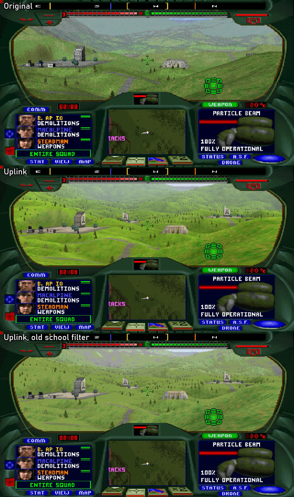

Le jeu tourne toujours dans DOSBox : c'est bien le vrai jeu qui joue. Un petit pont lit son état environ 120 fois par seconde et Uplink dessine la même scène, avec le vrai cockpit du jeu par-dessus.

Cliquer dans la fenêtre pour prendre la souris : elle regarde, les boutons tirent et verrouillent. `Y` ou `Pause` donne le curseur du jeu (boutons du cockpit, carte). `F12` passe au look old school. Toutes les autres touches vont au jeu. Fermer Uplink pour arrêter.

## Galerie

| | |
|---|---|
| 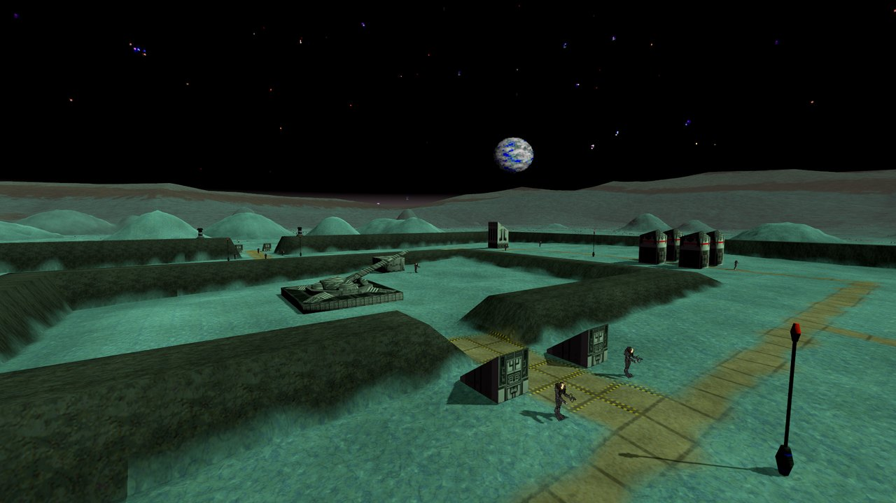 | 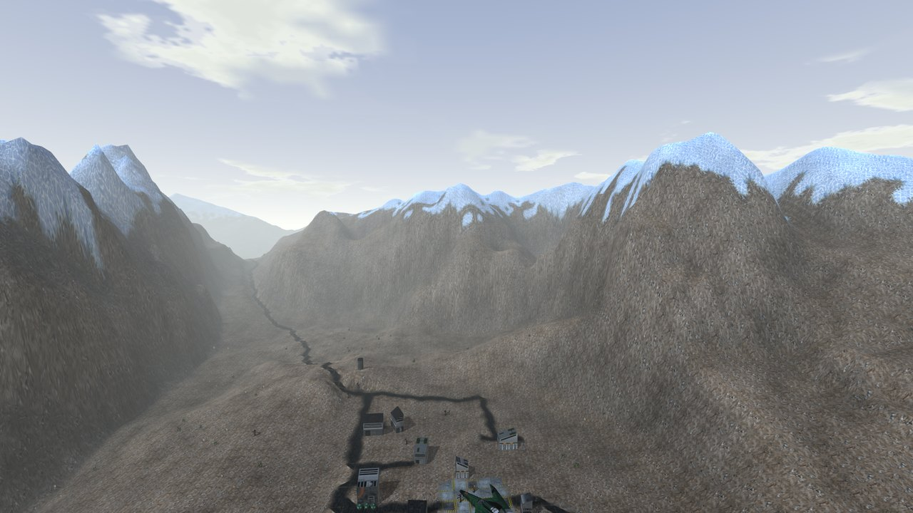 |
| 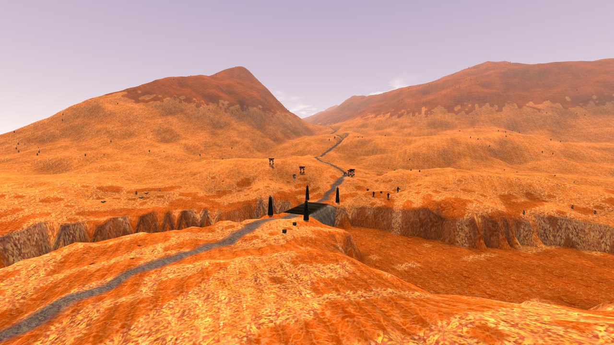 | 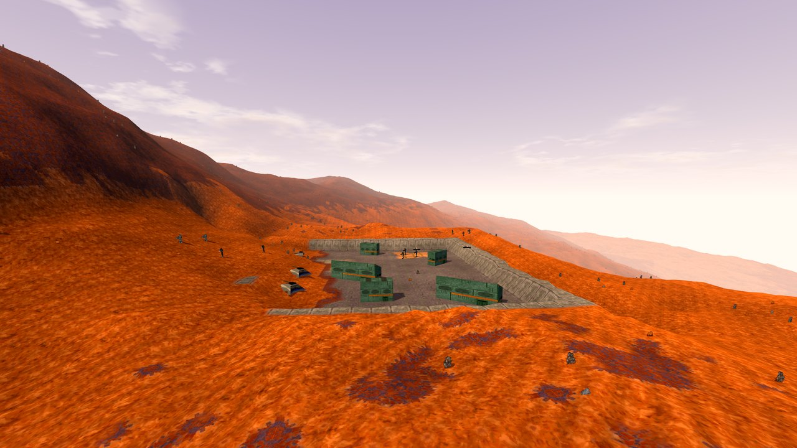 |
| 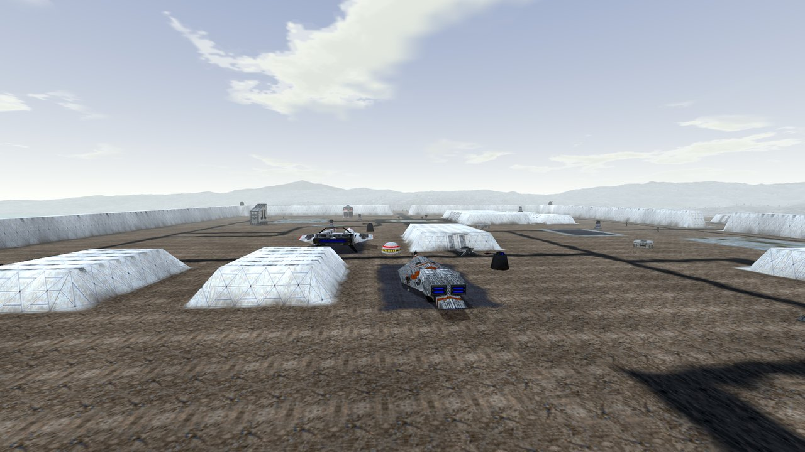 | 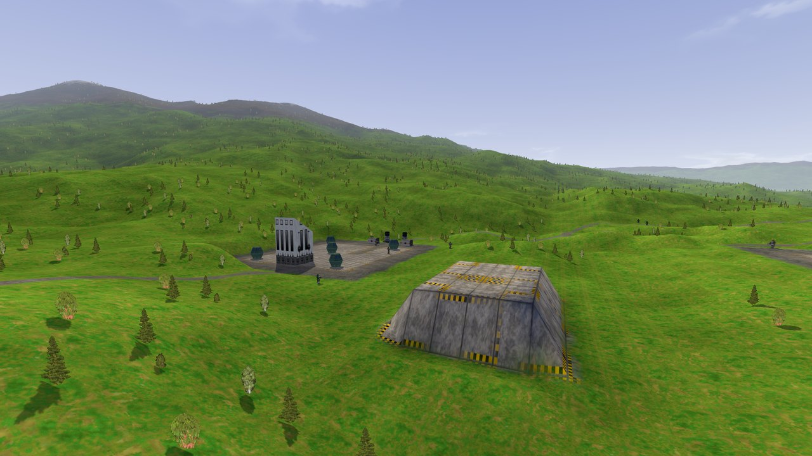 |
| 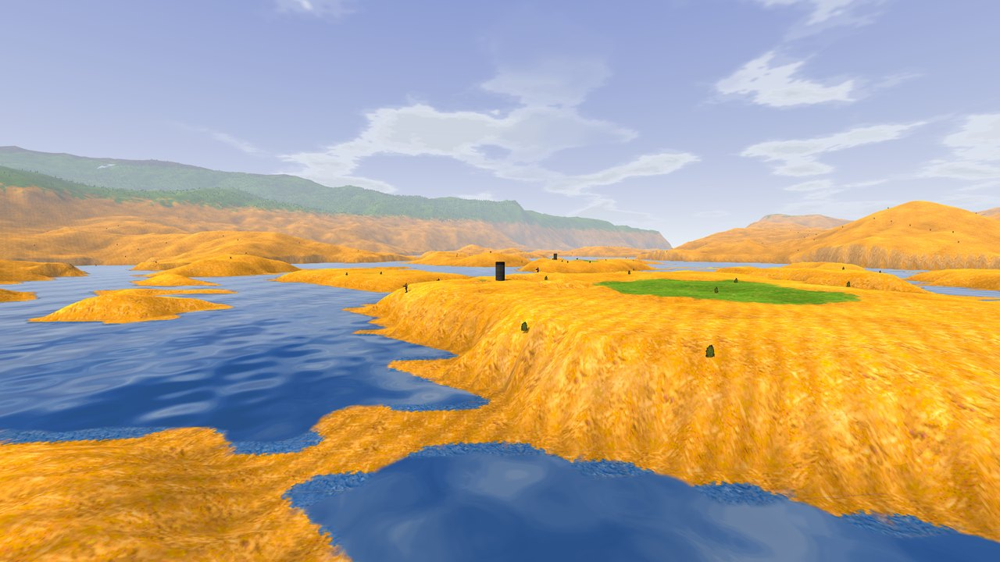 | 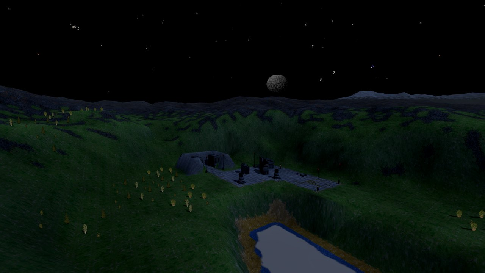 |
| 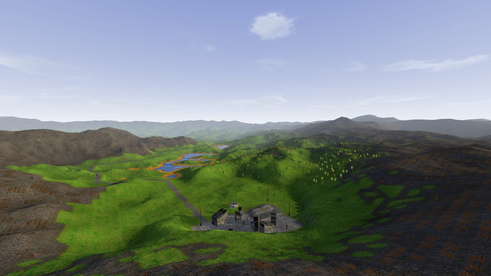 | 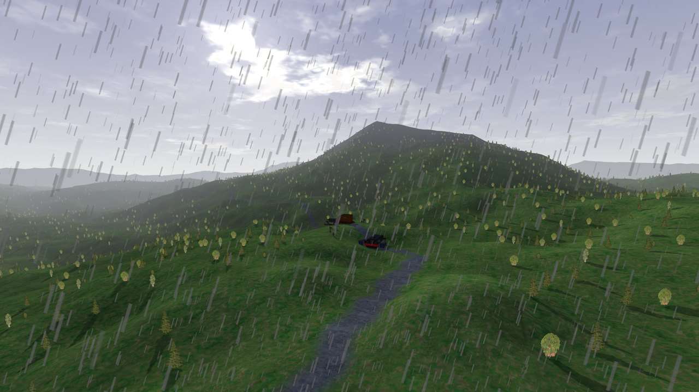 |
|  |  |

## Visualiseur de cartes

Les 37 missions de la campagne, l'entraînement, les deux missions coupées, les cartes du générateur de missions et les démos, avec les vrais sols, modèles 3D, soldats, forêts et ciels du jeu. La dernière entrée de la liste est une galerie des 119 modèles 3D.

| Touche | Action |
|---|---|
| Clic droit + souris | regarder |
| ZQSD / WASD | se déplacer |
| Espace / Ctrl | monter / descendre |
| Maj / molette | plus vite / vitesse |
| Tab | liste des missions |
| F2 / F3 / F4 | étiquettes / repères de mission / arbres |

Petite trouvaille : des têtes de l'île de Pâques sont cachées sur la planète rouge dans *Opération Taudis*.

## Bon à savoir

- C'est un prototype : Windows seulement, quelques effets d'armes ne sont pas encore dessinés, et le pont écrit dans la mémoire du jeu pour tes commandes, comme [Terra Nova Plus](https://github.com/skw-1337/terra-nova-plus).
- Cinématiques HD : `tools/upscale_movies.py` agrandit une fois les vidéos du jeu sur ton PC (il faut ffmpeg, Real-ESRGAN et RIFE).
- Pour les moddeurs : [notes techniques](docs/formats.md) (en anglais).

Installation manuelle (sans le lanceur)

Visualiseur de cartes :
1. Télécharger [Godot 4.7](https://godotengine.org/download/windows/) (version standard) et le dézipper.
2. Télécharger ce dépôt (**Code** → **Download ZIP**), le dézipper et double-cliquer sur **`Map viewer.bat`**. Si le jeu n'est pas trouvé, Uplink demande son dossier.

Mode Live, en plus :
1. Installer [Python 3](https://www.python.org/downloads/) 64 bits, puis lancer `pip install numpy psutil`.
2. Lancer le jeu avec [Terra Nova Plus](https://github.com/skw-1337/terra-nova-plus), Display **HD 848x480**.
3. Double-cliquer sur **`Live (prototype).bat`**. Il trouve la mission en cours et ouvre Uplink dessus.

## Mentions

Projet de fan, sans lien avec les ayants droit du jeu ni avec la Godot Foundation. Fait avec [Godot](https://godotengine.org). Il faut sa propre copie du jeu. Code sous [licence MIT](LICENSE).
