# Terra Nova Uplink

*Terra Nova: Strike Force Centauri* (Looking Glass, 1996) redrawn in modern 3D while the real game keeps running underneath. It uses your own copy of the game (GOG or Steam). No game files are included.

*Made with the help of Claude Code (an AI coding tool), mostly for reverse engineering the game and writing the code. Every change is tested in the real game before release.*

*Version française : [README.fr.md](README.fr.md)*

> **2.8 is in beta.** Graphics presets, an order wheel for the squad, an in-game menu, accessibility options and a lot of co-op work. The launcher offers it ("Try the beta") and you can go back at any time.
> [Full changelog](https://github.com/skw-1337/terra-nova-uplink/releases/tag/v2.8.0-beta.1) · [Pictures and roadmap](https://www.ttlg.com/forums/showthread.php?t=153557&p=2545417#post2545417)

## What it does

Three things, from one launcher:

- **Play** the campaign: the game runs in DOSBox and Uplink redraws it live, cockpit included.
- **Co-op** (experimental): a friend takes a seat in your squad, over Steam.
- **Map viewer**: fly around every map of the game without starting it.

## Features

What is new in the 2.8 beta is marked `2.8`.

**Playing**

- The game's own cockpit, HUD and map over a modern 3D view, at your screen's resolution
- Mouse look, key remapping, second binds on the wheel and the extra mouse buttons
- Order wheel for the squad: hold a button, pick an order, choose who gets it `2.8`
- In-game menu on Esc: controls, graphics, options, accessibility `2.8`
- Gamepad support, with remapping `2.8`
- Photo mode `2.8`, screenshots, frame limit
- Start at any mission of the campaign

**Look**

- Graphics presets: Original, Classic+, Modern, Light, with a preview of every option `2.8`
- Old school look: the game's own pixels and palette, on one key
- Weapons redrawn from the game's own effects: beams, trails, impacts, explosions
- Light from shots, and scorch marks where they hit `2.8`
- Footprints, vehicle tracks, cloud shadows `2.8`
- Look down and see your own legs `2.8`
- Snow, rain, night missions, and each planet its own light

**Accessibility** `2.8`

- Colour-blind modes: protanopia, deuteranopia, tritanopia
- Subtitles for squad chatter, in three sizes

**Co-op** (experimental)

- Two players in the same mission over Steam: one hosts his campaign, the other joins
- Briefing videos and launch cinematics on both screens
- The guest gets the game's own cockpit, with his own sound, settings and aim `2.8`
- Not there yet for the guest: drone, A.S.F., guided missiles
- How it works and troubleshooting: [COOP.md](COOP.md)

**Launcher**

- One exe: it finds your game, installs everything else and keeps it up to date
- Checked downloads, roll back to the previous version, beta channel
- Music of your choice: Roland / GS, FM, the game's own, or AWE32 with your own ROM dump `2.8`

| | |
|---|---|
| 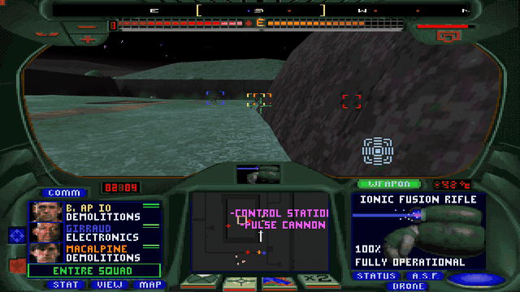 | 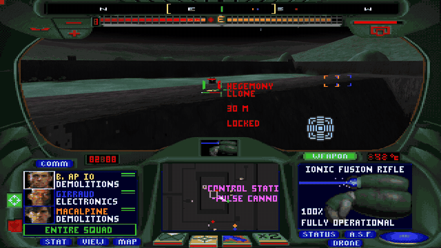 |
| 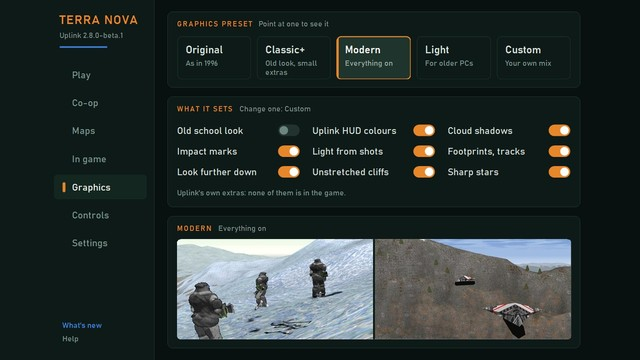 | 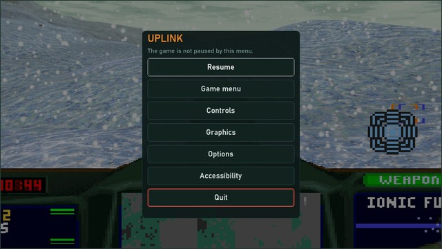 |
| 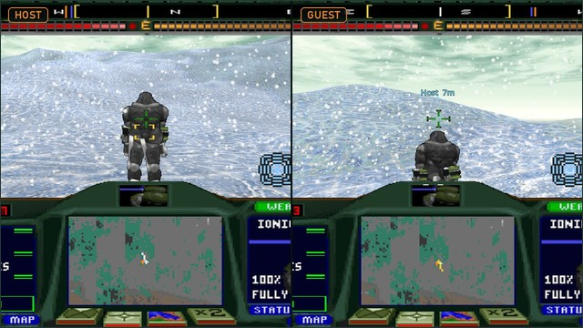 | 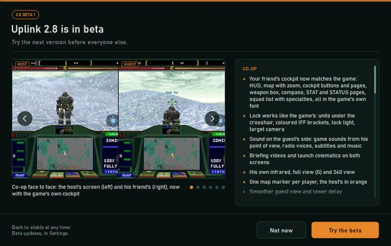 |

## Quick start

1. Download **Terra Nova Uplink.exe** from the [latest release](https://github.com/skw-1337/terra-nova-uplink/releases/latest).
2. Put it in an empty folder and run it. It finds your game, downloads the rest and keeps it up to date.
3. Click **PLAY** (live mode), **MAP VIEWER**, or **HOST A GAME** / **JOIN A FRIEND**.

Windows may warn about an unknown app (not signed): More info, then Run anyway.

## Live mode

Same moment: the original game, Uplink, and Uplink with its old school filter (`F12`).

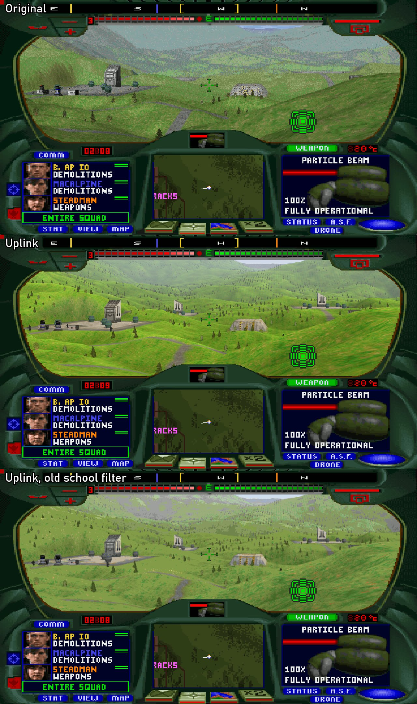

The game keeps running in DOSBox, so it's still the real game you play. A small bridge reads its state about 120 times a second and Uplink draws the same scene, with the game's own cockpit on top.

Click in the window to take the mouse: it looks around, the buttons fire and lock. `Y` or `Pause` gives you the game's cursor (cockpit buttons, map); the freelook key you set in **Game keys** replaces `Y`. `F12` switches to the old school look, `Shift+F12` makes its pixels finer; both keys can be changed in the launcher (**Keys**), which can also swap the crosshair for a dot or hide it. Every other key goes to the game, and so do the wheel and the extra mouse buttons you set in **Game keys**. Close Uplink to stop.

## Gallery

| | |
|---|---|
| 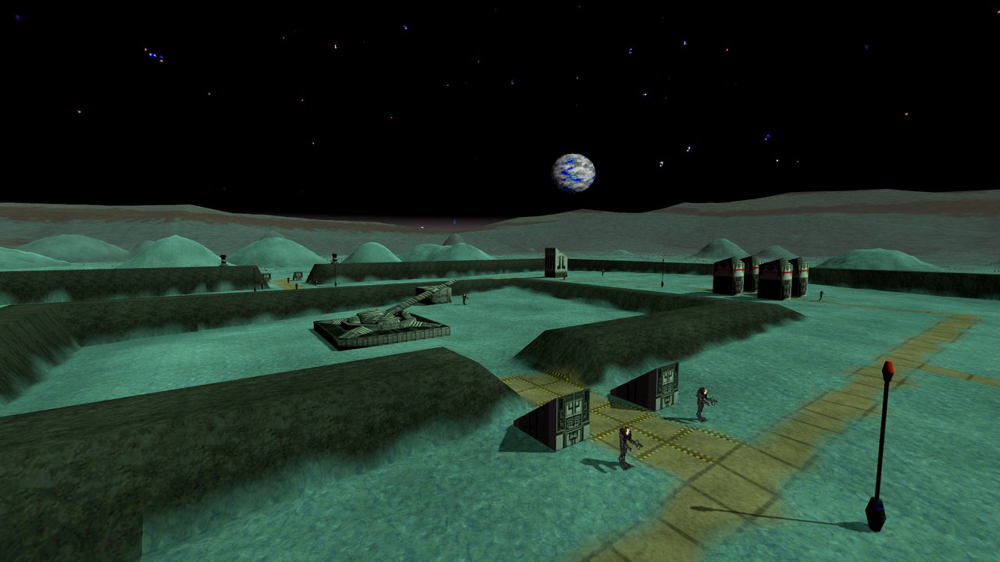 | 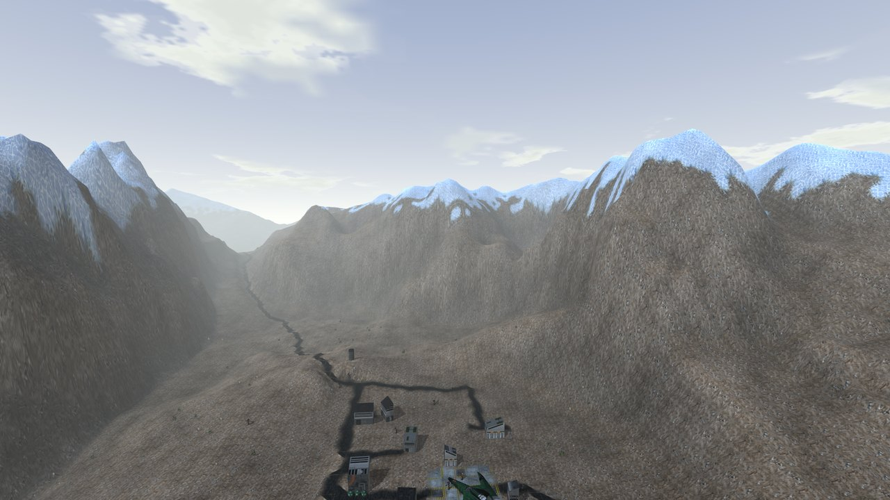 |
| 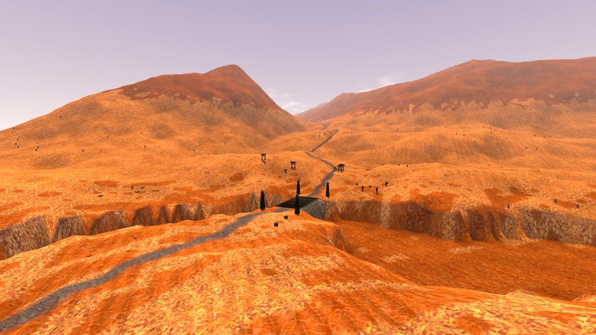 | 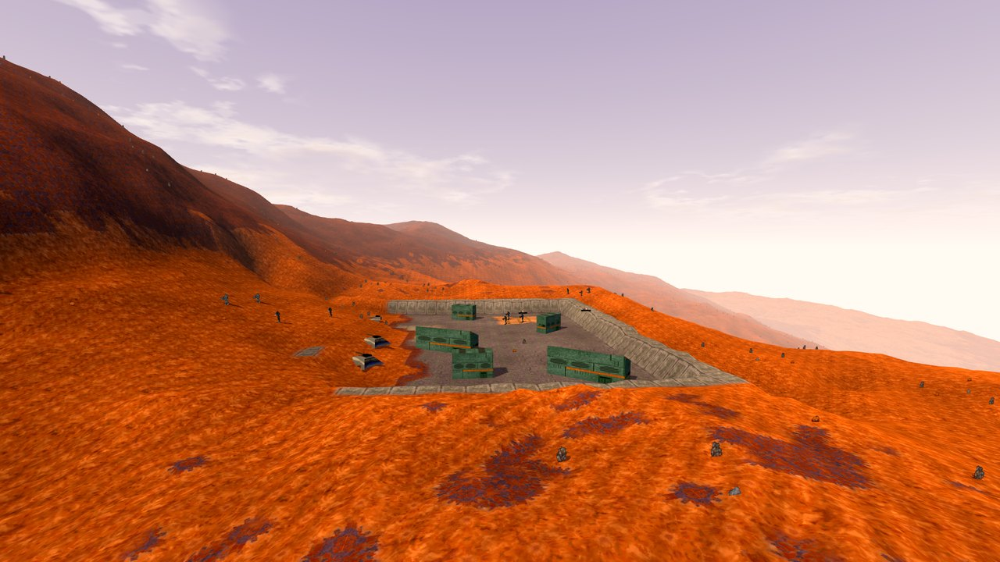 |
| 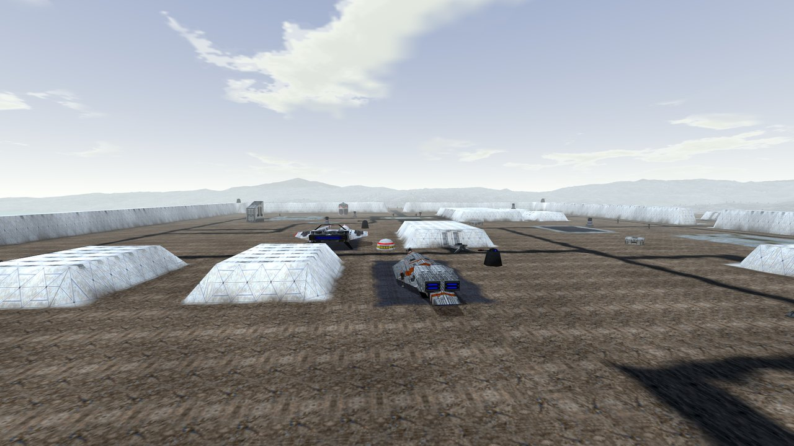 | 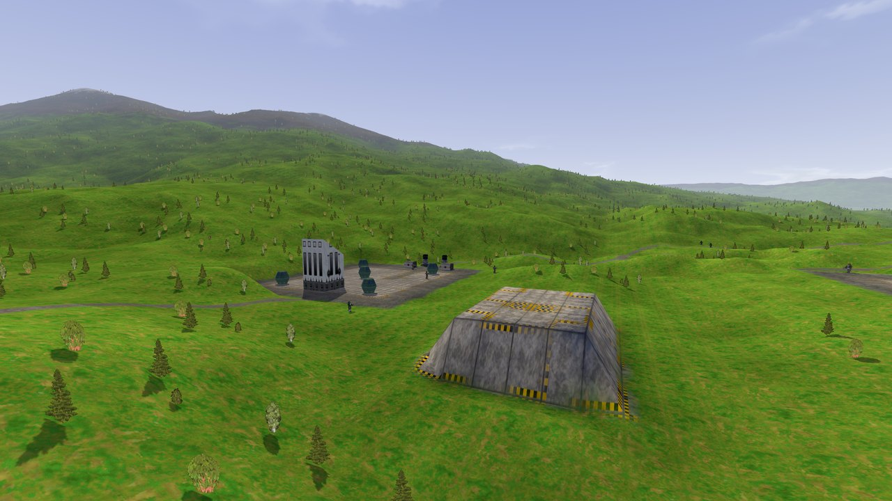 |
| 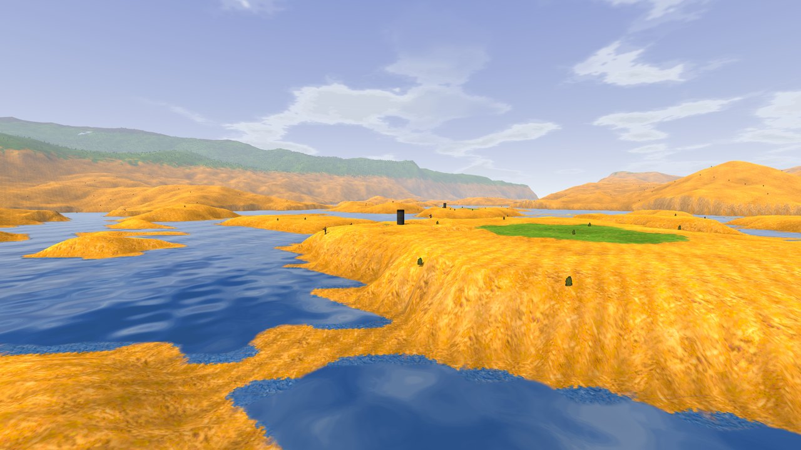 | 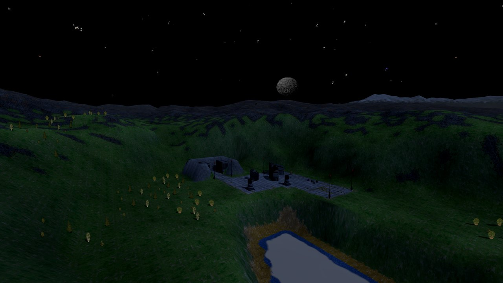 |
| 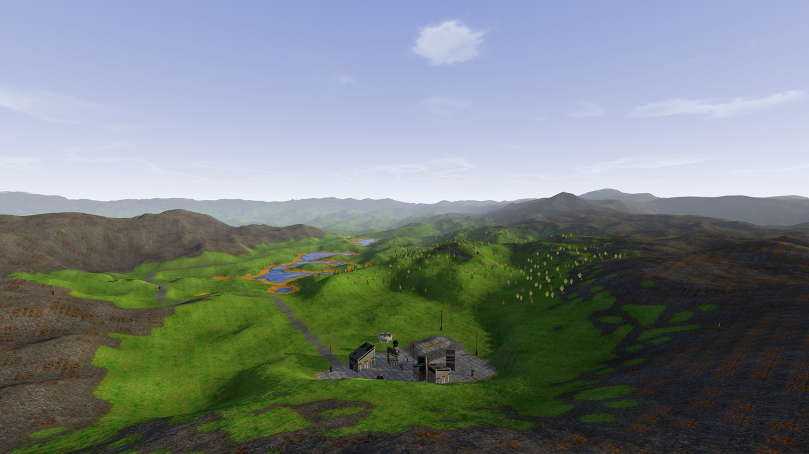 | 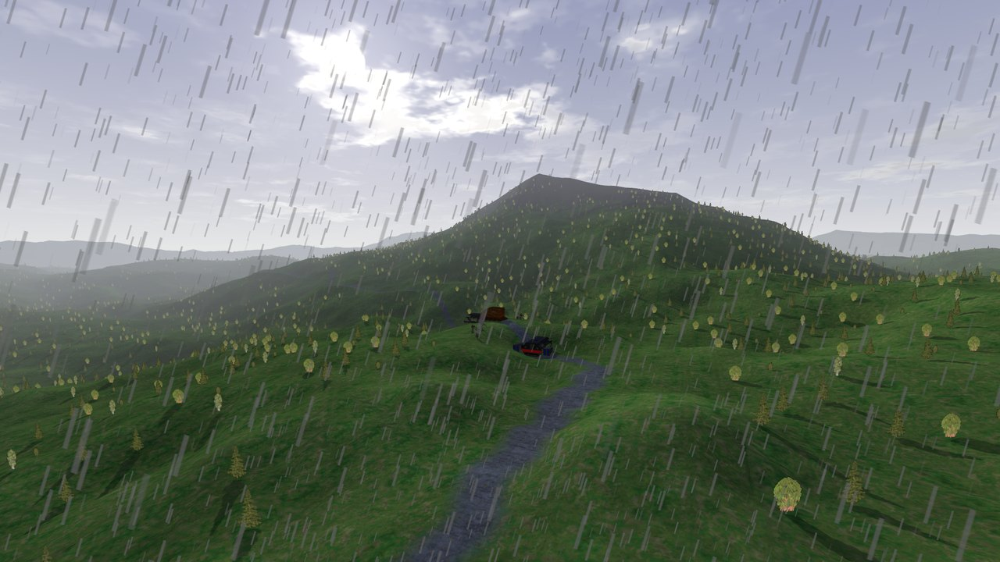 |
|  |  |

## Map viewer

All 37 campaign missions, training, the two cut missions, the mission generator maps and the demos, with the game's own ground, 3D models, soldiers, forests and skies. The last entry of the list is a gallery of all 119 3D models.

| Key | Action |
|---|---|
| Right mouse button + mouse | look around |
| WASD / ZQSD | move |
| Space / Ctrl | up / down |
| Shift / mouse wheel | faster / speed |
| Tab | mission list |
| F2 / F3 / F4 | labels / mission markers / trees |

Fun find: there are Easter Island heads hidden on the red planet in *Operation Pigpen*.

## Good to know

- Windows only. Co-op is experimental. The bridge writes into the game's memory for your controls, like [Terra Nova Plus](https://github.com/skw-1337/terra-nova-plus) does.
- HD cutscenes: `tools/upscale_movies.py` upscales the game's videos once on your PC (needs ffmpeg, Real-ESRGAN and RIFE).
- For modders: [technical notes](docs/formats.md).

Manual install (without the launcher)

Map viewer:
1. Get [Godot 4.7](https://godotengine.org/download/windows/) (standard version) and unzip it.
2. Download this repo (**Code** → **Download ZIP**), unzip it and double-click **`Map viewer.bat`**. If the game isn't found, Uplink asks for its folder.

Live mode, also:
1. Install 64-bit [Python 3](https://www.python.org/downloads/), then run `pip install numpy psutil`.
2. Start the game with [Terra Nova Plus](https://github.com/skw-1337/terra-nova-plus), Display **HD 848x480**.
3. Double-click **`Live (prototype).bat`**. It finds the mission in progress and opens Uplink on it.

## Legal

Fan project, not affiliated with the game's rights holders or with the Godot Foundation. Made with [Godot](https://godotengine.org). You need your own copy of the game. Code under the [MIT License](LICENSE).
